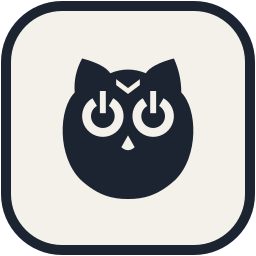

<p align="center">
  
</p>

<h1 align="center">Commander Owl</h1>

<p align="center">
  Watches your Claude Code sessions and powers your laptop down the moment they finish.
</p>

Commander Owl is a small, local dashboard for Windows. It lists your running Claude Code sessions and lets you arm rules such as "hibernate when this conversation finishes", "shut down when every session is idle", or "sleep at 23:30 on weekdays". Every rule has a countdown you can cancel, and sending a new prompt in a watched session cancels its rule automatically.

## Features

- **Session rules:** act when a specific session finishes its run or closes.
- **All-idle rules:** act once no tracked session is still working.
- **Clock and timer rules:** one-off, daily, or weekday schedules, plus "in N minutes".
- **Actions:** hibernate, sleep, shut down, or lock.
- **Safety first:** a countdown with a cancel button, and a dry-run mode that logs what would happen without touching power.
- **Sessions appear by conversation name,** and renames are picked up automatically.
- **Works with sessions opened before install:** the engine reads Claude's transcript files as a fallback.
- **Local only:** the dashboard listens on `127.0.0.1` and rejects cross-site requests.
- **No dependencies:** Python 3 standard library and plain HTML.

## Requirements

- Windows 10 or 11
- Python 3.10 or newer
- Claude Code
- Hibernate enabled for the hibernate action (`powercfg /hibernate on`, as an administrator)

## Setup

1. Clone the repository into `%USERPROFILE%\.claude\hibernate-hub`.
2. Install the Claude Code hooks:

   ```bash
   python install.py
   ```

   This backs up `~/.claude/settings.json` first, then adds the hook entries. Re-running it is safe.
3. Start the engine once, or let the next Claude Code prompt start it:

   ```bash
   python hook.py
   ```

4. Open the dashboard at http://127.0.0.1:47821/.

To start the engine at login, copy `start-hub.vbs` into your Startup folder (`shell:startup`). Adjust the Python path inside it to match your install.

## How it works

Claude Code hooks (`SessionStart`, `UserPromptSubmit`, `Stop`, `SessionEnd`) send events to `hook.py`, which forwards them to the engine (`server.py`). The engine keeps the session list and rules in a local `state.json` and runs `shutdown.exe` when a rule's countdown ends. Sessions that predate the hooks are discovered from `~/.claude/projects/*.jsonl`.

## Privacy

`state.json` contains your recent prompts and conversation titles. It stays on your machine and is excluded from git.

## Contributing

Issues and pull requests are welcome. See [CONTRIBUTING.md](CONTRIBUTING.md).

## License

[MIT](LICENSE)
