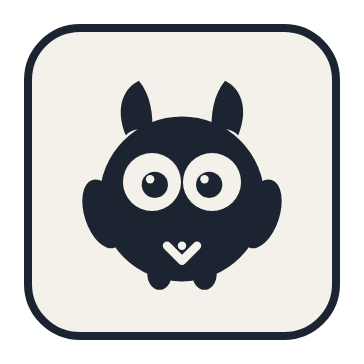
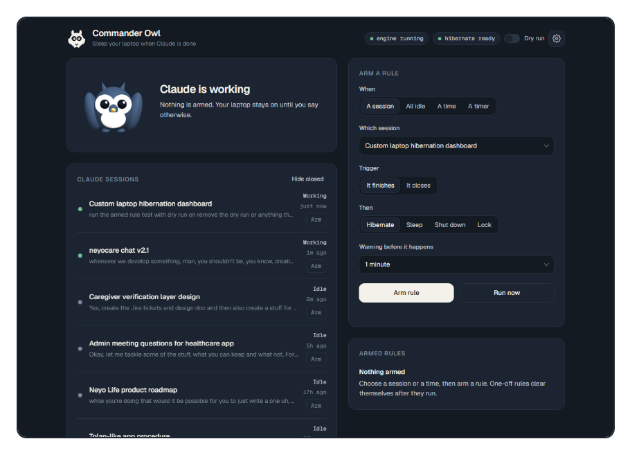

<p align="center">
  
</p>

<h1 align="center">Commander Owl</h1>

<p align="center">
  Sleep your laptop when Claude Code is done, not before.
</p>

<p align="center">
  
</p>

Commander Owl is a small local dashboard for Windows. It lists your Claude Code sessions, shows which ones are working, and lets you arm a rule such as "hibernate when this conversation finishes", "shut down when every session is idle" or "sleep at 23:30 on weekdays". While a rule is armed, the laptop stays awake, so Windows' own sleep timer cannot cut a long run short. Only your rule powers the machine off.

## Features

- **Session rules:** act when a conversation finishes its run or closes.
- **Background agents count:** a session stays "working" while its parallel agents are still running, even after the main reply has ended.
- **All-idle rules:** act once no tracked session is still working.
- **Clock and timer rules:** one-off, daily or weekday schedules, or "in N minutes".
- **Actions:** hibernate, sleep, shut down or lock.
- **Keep-awake while armed:** Windows' idle sleep timers are overridden until the rule fires or is removed.
- **Countdown with cancel:** every rule can warn first. Sending a new prompt in the watched session cancels it and re-arms the rule.
- **Windows notification:** a balloon and a system sound when a countdown starts, so you hear it away from the desk. Turn it off in settings.
- **Light and dark themes**, and a 3D mascot that reacts to what the engine is doing.
- **Local only:** the dashboard listens on `127.0.0.1` and rejects cross-site requests.
- **No dependencies on the server:** Python 3 standard library only. The page loads Three.js and the Geist font from their CDNs.

## Requirements

- Windows 10 or 11
- Python 3.10 or newer
- Claude Code
- Hibernate enabled for the hibernate action (`powercfg /hibernate on`, from an administrator shell)

## Setup

1. Clone the repository into `%USERPROFILE%\.claude\hibernate-hub`.
2. Install the Claude Code hooks:

   ```bash
   python install.py
   ```

   This backs up `~/.claude/settings.json` first, then adds the hook entries. Re-running it is safe.
3. Start the engine once, or let the next Claude Code prompt start it:

   ```bash
   python hook.py
   ```

4. Open the dashboard at http://127.0.0.1:47821/.

To start the engine at login, copy `start-hub.vbs` into your Startup folder (`shell:startup`). Adjust the Python path inside it to match your install.

## How it works

- **Claude Code hooks** (`SessionStart`, `UserPromptSubmit`, `Stop`, `SessionEnd`) send events to `hook.py`, which forwards them to the engine (`server.py`). Hooks tell the engine which sessions exist and when one closes.
- **Transcript files** under `~/.claude/projects/` decide working versus idle. A session is working while its own reply is open or any of its `subagents/*.jsonl` files is still mid-turn. This also finds sessions that were opened before the hooks were installed.
- **Keep-awake:** while any rule is armed, the engine calls `SetThreadExecutionState` with `ES_SYSTEM_REQUIRED`. It re-sends the request every second.
- **Power actions** run `shutdown.exe` (`/h`, `/s`, `/l` or a lock) after the countdown.

## Limits

- **Lid close and the power button** still follow Windows. Set the lid action to "Do nothing" in Windows Power options if you want the lid to be ignored while armed.
- **Critical battery** makes Windows hibernate no matter what.
- **Closed versus idle:** sessions that started after the hooks were installed report a real close. Older sessions found only from their transcript files show as idle when quiet.
- **Only Claude Code is tracked today.** The app setting lists Codex and other apps as "soon".

## Privacy

`state.json` contains your recent prompts and conversation titles. It stays on your machine and is excluded from git. The repository never contains it.

## Contributing

Issues and pull requests are welcome. See [CONTRIBUTING.md](CONTRIBUTING.md). Security reports: see [SECURITY.md](SECURITY.md).

## License

[MIT](LICENSE)
